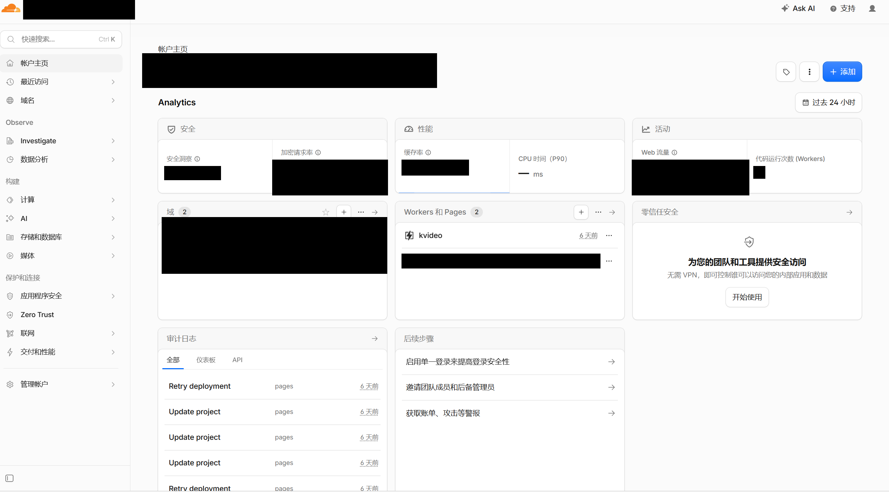

# Cloudflare Pages 部署实践

## 项目介绍

使用 Cloudflare Pages 对个人 Web 项目（开源视频聚合平台 KVideo）进行部署与项目管理实践，了解静态网站托管和 HTTPS 访问的基本流程。

## 使用技术

- Cloudflare Pages
- GitHub
- DNS（管理面板查看）
- HTTPS / SSL（Cloudflare 提供）
- CDN（原理学习）

## 实践内容

### 1. 项目部署

- 使用 Cloudflare Pages 连接 GitHub 仓库
- 配置项目构建参数
- 通过 Git 推送触发自动部署

### 2. 域名与网络（了解）

- 在 Cloudflare DNS 管理面板中查看域名解析记录
- 了解 HTTPS 访问由 Cloudflare 自动提供
- 了解 CDN 加速原理

### 3. 部署过程记录

- 查看部署日志
- 查看项目构建过程及部署记录
- 了解 Pages 项目的构建配置与部署流程

## 项目成果

基于开源项目 KVideo（MIT 许可证，上游作者 Kuek Hao Yang）进行历史项目部署实践：

- 通过 GitHub 与 Cloudflare Pages 集成进行部署
- 在控制台查看和管理 Pages 项目及部署记录
- 尝试 Cloudflare Workers 迁移和服务端功能验证

项目即"春秋影视"入口。因持续更新维护成本较高，已停止维护，原访问地址已失效。

## 学习收获

通过本项目熟悉了从代码托管到网站构建部署的基本流程，了解 Cloudflare Pages 的构建部署机制以及域名、HTTPS 的基本概念。
