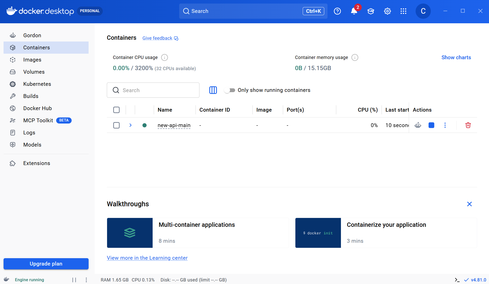

# Docker 容器化部署实践

## 项目介绍

使用 Docker Desktop 搭建本地服务运行环境，通过 Docker Compose 编排 new-api（AI 模型网关）+ PostgreSQL + Redis 三服务应用。

## 使用技术

- Docker / Docker Desktop（v4.81.0）
- Docker Compose（5.1.4）
- PostgreSQL 15、Redis

## 实践内容

### 1. 多服务编排

使用 docker-compose.yml（文件版本 3.4）定义并运行三个服务：

| 服务 | 镜像 | 说明 |
| --- | --- | --- |
| new-api | calciumion/new-api | AI 模型网关，端口映射 3000:3000 |
| postgres | postgres:15 | 数据库 |
| redis | redis:latest | 缓存 |

编排配置要点（与 compose 文件原文一致）：

- 服务依赖：使用 `depends_on` 声明 new-api 与 Redis、PostgreSQL 之间的服务依赖关系
- 网络：三个服务接入自定义桥接网络 `new-api-network`
- 数据持久化：postgres 使用命名卷 `pg_data`；new-api 挂载 `./data:/data` 与 `./logs:/app/logs`
- 重启策略：三个服务均设置 `restart: always`
- 健康检查：new-api 配置 healthcheck（每 30 秒探测 `/api/status` 接口，超时 10 秒，失败重试 3 次）
- 日志：new-api 以 `--log-dir /app/logs` 参数运行，日志输出到挂载目录

### 2. 容器管理

- 拉取和管理镜像
- 启动、停止容器，查看运行状态（docker ps / Docker Desktop）
- 查看并确认容器的端口映射配置（3000:3000）

### 3. 服务调试（学习了解）

- 了解容器日志的查看方法
- 了解常见容器异常（启动失败、端口冲突）的排查思路

## 学习收获

掌握 Docker 基础操作和 Docker Compose 多服务编排流程，理解服务依赖、自定义网络、数据卷和健康检查在多容器应用中的作用。
