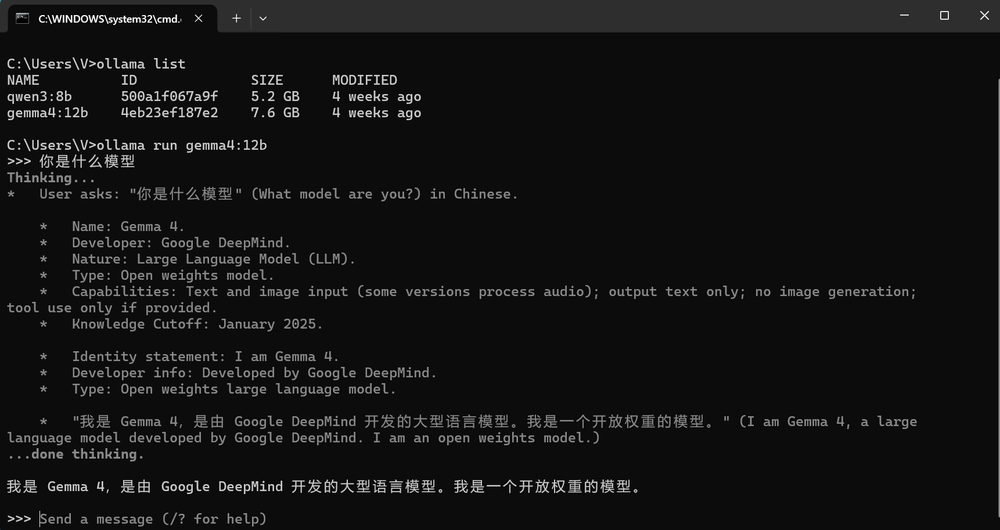

# Ollama 本地大模型部署实践

## 项目介绍

在个人电脑（Windows 11）中部署 Ollama 本地大语言模型运行环境，实践开源模型的下载、管理与命令行对话。

## 使用技术

- Ollama
- 开源大语言模型（qwen3、gemma4）
- Windows 11

## 实践内容

### 1. 环境搭建

- 在 Windows 11 上安装并启动 Ollama
- 了解本地模型的运行方式和存储目录结构

### 2. 模型下载与管理

- 下载并运行两个开源模型：
  - `qwen3:8b`（模型文件约 5.2 GB）
  - `gemma4:12b`（模型文件约 7.6 GB）
- 使用 `ollama list` 查看和管理本地模型

### 3. 本地对话测试

- 使用 `ollama run` 在命令行调用模型
- 测试中文文本生成与对话效果
- 了解模型大小、量化方式的基本概念

## 项目成果

在个人电脑上实现本地大模型的下载、管理与本地对话：

- 本地运行 qwen3:8b、gemma4:12b 两个开源模型
- 命令行完成模型调用与中文对话验证

## 学习收获

了解本地大模型部署的基本流程：环境安装、模型下载管理、命令行推理的使用。
